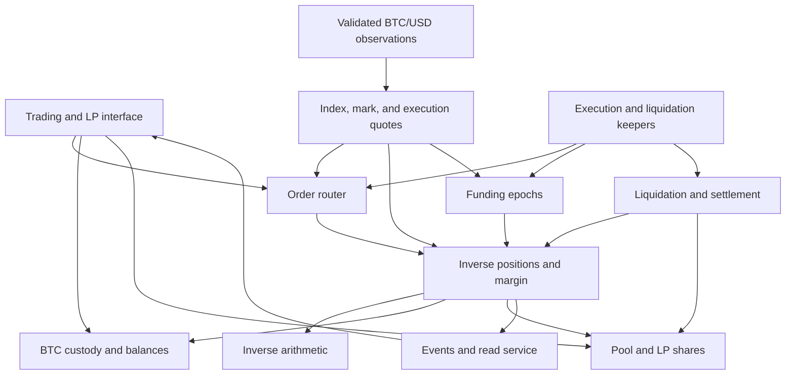

# Proposed architecture

Planning draft, 2026-10-27. This describes components to build; named contracts and services do not yet exist.

## System boundaries

The exchange runs in custom contracts on HyperEVM testnet. HyperEVM's documented testnet chain ID is 998, its RPC is `https://rpc.hyperliquid-testnet.xyz/evm`, and gas is paid in HYPE. [HyperEVM documentation](https://hyperliquid.gitbook.io/hyperliquid-docs/for-developers/hyperevm)

The market uses its own execution, margin, and liquidation rules. It does not inherit HyperCore's perpetual risk engine merely by running on the same chain. HyperCore price reads are an optional input; HyperCore hedge orders are a later integration.



## Components

| Proposed component | Responsibility | Key constraint |
| --- | --- | --- |
| `MockBTC` | 8-decimal test collateral and faucet minting | Clearly mock; no backing or redemption claim |
| `CollateralVault` | Custody, free/allocated collateral, internal transfers, withdrawals | Only authorized accounting paths move reserved funds |
| `InverseMath` | P&L, entry accumulators, fees, margin math | Explicit units and tested rounding |
| `InverseMarket` | One-way positions and isolated collateral | Funding applied before position mutations |
| `OrderRouter` | Requests, limits, TP/SL, nonce/deadline/slippage validation | No keeper discretion over arbitrary fill prices |
| `LiquidityPool` | LP shares, NAV, risk capital, reserves, withdrawals | Open liabilities included before distribution |
| `OracleAdapter` | Normalize and validate observations | Provenance and freshness are part of validity |
| `PricingEngine` | Index/mark distinction and executable pool quotes | Bounded skew/spread and reproducible quotes |
| `FundingEngine` | Epoch parameters, observations, global accumulator | No double application or missed-epoch forgiveness |
| `LiquidationEngine` | Health, forced closes, loss allocation | Cannot seize unrelated free collateral |
| `EmergencySettlement` | Freeze snapshot and deterministic recovery | Same recovery regardless of claim order |
| Keeper services | Submit permissionless actions and required data updates | Restartable, observable, and unable to withdraw user assets |
| Read service/UI | Present confirmed state and transaction history | Contract state remains authoritative |

Module boundaries are conceptual. Keep implementation small where possible; use measured contract size, gas, and independent testing needs to decide physical contract boundaries.

## Price and execution decisions

Use an adapter interface returning at least price, decimals, source/round identity, and source observation time. A relayer's submission time must not be presented as the original source timestamp.

Stage 0 should evaluate a timestamped BTC/USD oracle available on chain 998. If none is practical, use an explicitly trusted **testnet price publisher** that records independently collected live observations, source timestamps, and monotonic rounds. Label that trust assumption in the deployment manifest and interface. Validate round replay, stale data, impossible timestamps, and divergence checks on-chain.

HyperCore precompiles can expose prices to HyperEVM, and CoreWriter can send actions back. The documented execution ordering means a submitted action is not a synchronous confirmed trade. Price-read freshness and action completion must be tested separately. [HyperCore integration documentation](https://hyperliquid.gitbook.io/hyperliquid-docs/for-developers/hyperevm/interacting-with-hypercore)

Do not infer price-source freshness solely from a recent EVM block or heartbeat. If the selected precompile does not expose enough provenance/timing, add a validated timestamped source or retain it only as a cross-check.

For reproducible failures, deploy a separate test market with a controlled oracle. Its updater role is deliberately privileged and must never be confused with the live-price market.

The proposed order architecture uses requests followed by validated execution. Stage 0 must decide how a request binds to an eligible observation, how competing updates are ordered, and when cancellation is allowed. Stage 3 must demonstrate that neither a late keeper nor a trader obtains a free option over historical prices. If that cannot be shown, redesign execution before deployment.

## Pool valuation and bounded work

The initial market has a hard cap on simultaneously open accounts; **32 is a proposed starting value**, subject to gas measurements. This allows exact bounded account scans for risk/NAV checks while avoiding unsafe assumptions that all trader debt is collectible. Batch liquidations and settlement with explicit progress tracking.

Keep free cash, allocated position cash, LP capital, insurance, protocol fees, and rounding residuals separately attributable. Unrealized P&L affects obligations and LP NAV but does not create token balances. Track a snapshot identifier so oracle updates, funding changes, and position mutations cannot be mixed into an inconsistent valuation.

LP withdrawals require a fresh valuation and enough remaining capital for existing claims and reserves. Direct token donations must not distort LP share issuance. Use slippage bounds for share deposits/redemptions, and define bounded waiting/retry behavior when liquidity is reserved.

Do not raise account caps or change economic parameters underneath existing positions without a specified migration/checkpoint process. For the first testnet, prefer immutable economic settings per deployment and redeploy for incompatible changes.

## Operational states

| State | Expected behavior |
| --- | --- |
| Normal | Valid-price trading and funding; risk-checked collateral/LP withdrawals |
| Restricted | No new/increased exposure; valid-price reductions where safe; no stale-price settlement |
| Emergency settlement | Frozen economic snapshot and bounded settlement batches; deterministic claims |

Invalid oracle data disables price-dependent operations, including liquidation at invalid prices. Deposits and independently withdrawable free collateral may remain available when accounting permits. Recovery must reconcile pending orders and funding before reopening.

Administration can initialize roles and restrict operation, but should not have an unrestricted path to withdraw trader collateral or rewrite balances. Test oracle roles, deployer keys, and keeper keys remain distinct. Store secrets outside the repository; document public addresses and role permissions.

## Implementation tooling and future layout

- Solidity and Foundry for contracts, deterministic deployment, fuzzing, and invariants.
- Python with `Fraction` or `Decimal` for the independent economic model.
- TypeScript services and a small wallet UI; choose exact libraries and pin versions when implementation begins.
- `hyper-evm-lib` only where HyperCore reads or interactions are actually needed. Inspect and pin a revision before adoption.

Proposed directories, to be created in later stages:

```text
contracts/        Solidity modules, tests, scripts, deployment profiles
simulation/       Independent reference model, scenarios, fixtures, reports
services/keeper/  Oracle/execution/funding/liquidation workers
apps/web/         Testnet trading and LP interface
config/           Versioned market and risk parameters; no secrets
deployments/      Address manifests and transaction records
reports/          Test results, risk analysis, release acceptance evidence
docs/             This plan and future runbooks/decision records
```

## Optional HyperCore hedging

Add hedging only after the independent pool market passes acceptance. It requires an explicit model connecting inverse BTC liabilities to linear USDC-settled hedge exposure. It also introduces USDC margin, funding/basis differences, asset transfers, asynchronous fills, rejected orders, ADL/liquidation of the hedge, and recovery after RPC failures.

Never count a submitted order as a filled hedge or use unconfirmed hedge profits to authorize BTC withdrawals. Test those integration failures separately; the baseline testnet has no dependency on this module.
